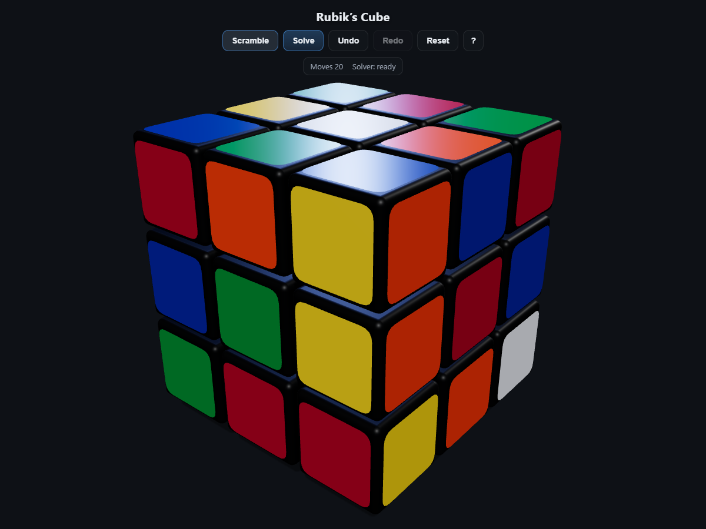

# Rubik's Cube 3D

[](https://rubik-cube-3d.rubik-cube-3d.workers.dev/)

**Try it live → https://rubik-cube-3d.rubik-cube-3d.workers.dev/**

Interactive 3D 3×3 Rubik's Cube simulator with a **real solver** (no faked
algorithms). Built with plain **Three.js** and vanilla JS modules.



## Run it

```
node server.mjs          # or npm start
# →  http://localhost:8000
```

Open in a modern desktop or mobile browser. No build step, no bundler, no
`node_modules`. Three.js is vendored in `vendor/`.

For the fastest first-run startup, generate the solver's pre-computed
PDB tables once:

```
npm run pregen      # phase-1 pairwise PDBs + CS + ES (~8 MB, ~1 s)
npm run pregenCE    # joint corner-class x edge PDB (111 MB, ~15 min, once)
```

The worker needs `data/jointCE.pdb` + `data/jointCE_qsym.pdb` for the fast
path. Without them it still solves exactly, but with a weaker phase-2
heuristic: **a few seconds per solve instead of milliseconds** — that fallback
is the only noticeably slow path, so keep those two files if you can.

`data/` is generated output (git-ignored), and both pregen scripts rewrite
`data/pdb_meta.json`: size + FNV-1a hash + the `tablesVersion()` that the file
was built for. The worker fetches that manifest first, then fetches
`/data/<name>.pdb?v=<v>` and drops any file whose stamped `v` is stale for the
current code or whose bytes hash differently — it rebuilds those tables locally
instead of pruning with wrong distances. `/data/*.pdb` is served with a year of
immutable caching (only `?v=` busts it), `data/pdb_meta.json` stays `no-cache`
because it carries the version. If you change the move table, the coordinates,
or a pregen script, re-run **both** pregen scripts so every file gets the new
`v`.

`data/` is git-ignored, so a git-based deploy ships no tables at all: run
`npm run pregen && npm run pregenCE` on the host (or ship `data/` out-of-band).
Put `npm run check` in CI — it exits 1 when `jointCE.pdb` is missing, stamped
for another code version, or hashed differently, so a misconfigured deploy fails
loudly instead of quietly solving in seconds.

```
node tests/pregen_two_phase.mjs   # phase-1 pairwise PDBs + CS + ES (~8 MB)
node tests/pregen_jointCE.mjs     # joint corner-class x edge PDB (111 MB, once)
node tests/pdb_manifest.mjs       # re-stamp data/pdb_meta.json for files on disk
```

## Controls

| Input                | Action                                                          |
| -------------------- | --------------------------------------------------------------- |
| Click `Scramble`     | New WCA-style 20-move scramble; also freezes the clock          |
| Click `Solve`        | Ask the solver worker (waits if the cube is mid-animation)      |
| Click `Cancel`       | Aborts the solve via shared memory (hidden when SAB is denied)  |
| Click `Undo` / `Redo`| Step through history / redo stack (undo takes back the last applied move, queued moves are dropped) |
| Click `Reset`        | Snap back to solved (clears history)                            |
| Click `Start`        | Timer mode: count down from the time you set                     |
| Click `Stop`         | Freeze the running countdown (button hidden until it runs)       |
| Click `− 5s` / `+ 5s`| Change the time in the timer — 1s…10min, works mid-run too       |
| Click `?` / press `H`| Toggle the in-app help overlay                                  |
| Drag / pinch         | Orbit / zoom the camera — unlimited 360° in any direction (mouse or touch) |
| `U D L R F B`        | Turn the face **relative to your current point of view** — they follow the camera, so no `y` rotation is needed first; shift = inverse; hold `2` = double |
| `M E S`              | Middle-slice turns, always absolute; shift = inverse; hold `2` = double |
| `x y z`              | Whole-cube rotations, always absolute (same inverse / double rules) |
| `Ctrl+Z` / `Ctrl+Y`  | Undo / Redo                                                      |
| `Esc`                | Reset                                                            |

Holding a face key is capped: the queue keeps at most 24 queued moves, so key
repeat cannot build an unbounded queue (dropped moves never enter history). The
help card owns the screen: while it is open, face keys and `Esc` do nothing and
only `H` toggles it.

The centre cubie of the face you are looking at blinks, and the status bar
shows the current front face. Solving the cube fires a confetti burst and a
"GG" popup, and freezes the countdown; clicking `Solve` freezes it too (letting
the solver work is not a timed run). Running the countdown out to 0:00 pops a
red "TIMEOUT" with the same animation as "GG".

All input is queued; you can hold keys down and rapid inputs do not corrupt
the animation state.

## Architecture

```
index.html                # entry point, import-map for `three`
styles.css                # UI styling
vendor/                   # three.module.js + RoundedBoxGeometry.js, vendored
src/
  constants.js            # geometry, colours, timing, camera defaults
  moves.js                # Singmaster parser + 24 exact integer rotation
                          # matrices + face/slice/whole-cube move tables
  CubeState.js            # 27 cubies, integer pos ∈ {-1,0,1}³, exact 3×3
                          # rot matrix; applyMove, isSolved, fingerprint, clone
  Scrambler.js            # 20-move WCA-style scrambler
  Solver.js               # two-phase (Kociemba-style) solver + PDB builders
  solver.worker.js        # Web Worker: fetch prebuilt PDBs (or rebuild),
                          # run two-phase search, post progress + cancellation
  Cubie.js                # one rounded cubie ( RoundedBoxGeometry body
                          # + offset sticker quads)
  Cube.js                 # 27-cubie scene, animation queue, undo/redo
                          # history, snap-to-logical after each turn
  Timer.js                # countdown: user-set time, Start/Stop, readout
  CameraRig.js            # orbit / zoom / pinch on a fixed-radius arc
  InputController.js      # keyboard + pointer input, queues moves to Cube
  UI.js                   # DOM buttons, status line, solved badge, help
  main.js                 # wires everything; owns the worker; SAB cancel
data/                     # pre-computed PDB files (~120 MB)
tests/
  logic.test.mjs          # 11 assertions across moves, states, solver
  solvecheck.mjs          # 34 two-phase solved-state checks (face, slice,
                          # whole-cube-prefix, solved-input cases)
  solvecheck2.mjs         # 18 seeded 20-move scrambles, replay-verified
  solver_e2e.mjs          # verify v1 optimal solver for len 2..10 (legacy)
  pregen_two_phase.mjs    # writes phase-1 pairwise + CS + ES PDBs
  pregen_jointCE.mjs      # writes the 111 MB joint PDB + qsym table
  pdb_manifest.mjs        # stamps data/pdb_meta.json (v + hash) the worker checks
  validate_jointCE.mjs    # independent BFS check of data/jointCE.pdb
  undo_browser.mjs        # Playwright: undo/redo against queued moves
  ux_browser.mjs          # Playwright: Solve-while-busy, key cap, help card, clock
  pdbvalidate.mjs         # Playwright: manifest v/hash gates the fetched PDBs
  interact.mjs            # Playwright browser interaction test
  solvebrowser2.mjs       # Playwright: scramble → Solve → badge checks
  scratch/                # ~90 exploratory one-off scripts (not part of npm test)
```

### Logical state (authoritative)

Every cubie carries an **exact 3×3 integer orientation matrix** and a
**discrete position** in `{-1,0,1}³`. Moves are applied by integer matrix
multiplication. Floating-point rotations are only for animation; every
commit snaps visuals back from the logical state.

### Rendering

- 27 individual rounded-box cubies (dark body, six coloured sticker quads
  offset from the body).
- Turn animation uses a temporary pivot group: affected cubies are
  attached → tweened with `smootherstep` → detached → snapped from
  logical state.
- Camera: perspective, fov 40°, fixed target, quaternion orbit (no poles),
  pinch-zoom clamped to 4.6–13 units.

### Solver

The solver is a real two-phase (Kociemba-style) search, run in a Web
Worker:

**Phase 1** — IDA\* over three coordinates (twist 3⁷, std-Gauge flip 2¹¹,
ud-slice C(12,4)=495) pruned by **three pairwise PDBs**:

| PDB (phase 1)        | Size        | Key                                   |
| -------------------- | ----------- | ------------------------------------- |
| twist × flip         | 4,478,976   | exact distance, 18 face moves         |
| twist × ud-slice     | 1,082,565   | "which 4 edges live in the E slice"   |
| flip × ud-slice      | 1,013,760   | pairwise exact                      |

Phase 1 iterates bounds and collects up to 12 candidate prefixes (one per
bound), sorted by `L + h2`.

**Phase 2** — IDA\* in the phase-2 subgroup (G1 = U U' U2 D D' D2 L2 R2
F2 B2) over corner-permutation rank (8!), edge-permutation rank (8!) and
E-slice 4! ranks, pruned by:

| PDB (phase 2)                | Size      | Key                                        |
| ---------------------------- | --------- | ------------------------------------------ |
| joint corner-class × edge    | 111,605,760 | 2768 D4h corner classes × 8! edge perms (exact, ≤18) |
| corner-perm × slice          | 967,680   | exact                                      |
| edge-perm × slice            | 967,680   | exact                                      |

Because the phase-1 flip coordinate uses the standard UD gauge, the phase-1
goal set (tw=0, flip=0, ud solved) is closed under G1, so the phase-2 search
is exact rank arithmetic (no per-node state tracking) and every returned
sequence is replay-verified against the authoritative logical state before
being sent to the UI.

The solver:

- Detects real whole-cube rotation from the **center positions** (not center
  rotations — face turns rotate face centers locally) and canonicalises the
  state with a shortest `x/y/z` prefix before searching.
- Never relies on memorised OLL / PLL: everything is PDB lookups + IDA\*.
- Returns near-optimal sequences (`optimal: false`; total is usually
  optimum +0–3). The v1 optimal-IDA* solver is kept in git history only.
- Cancellation is via a **SharedArrayBuffer** (`Int32Array(1)`) that both
  DFS loops poll every 131,072 nodes.

### Measured performance

| State                             | Time / notes                                    |
| --------------------------------- | ----------------------------------------------- |
| All PDBs built from scratch       | ~1s (without the 111MB joint PDB)               |
| jointCE PDB precompute (Node)     | ~15 min, one-time                               |
| PDB fetch (browser, `data/` pre-generated) | ~1s                                        |
| 2-move scrambles (all 243+ states) | ≤ 1 ms                                          |
| ≤10-move scrambles                | ≤ 100 ms                                        |
| 20-move scrambles (38 tested)     | **1–13 ms**, avg solution 23.3 moves, all replay-verified |

The 20-move cost is no longer fundamental: with the exact joint PDB the
phase-2 heuristic is within 0–2 of the true distance, so 20-movers solve in
single-digit milliseconds.

## Cross-thread cancellation

Web Worker `onmessage` cannot interrupt a tight synchronous DFS, so the
Cancel button uses `SharedArrayBuffer`. The main thread writes `flag[0]=1`;
the worker's DFS polls `cancelRef[0]` every 131,072 nodes. **`SharedArrayBuffer`
is only enabled when the page is cross-origin-isolated**, so `server.mjs`
sends:

```
Cross-Origin-Opener-Policy: same-origin
Cross-Origin-Embedder-Policy: require-corp
```

which sets `crossOriginIsolated = true`. Without those headers (any other static
host) there is no way to interrupt the search: the Cancel button stays hidden and
the status line says "cannot be cancelled here", so the solve runs to completion.

`server.mjs` also answers `400` for a malformed URL (`/%zz` used to throw inside
the handler and Node exited, taking the whole server down) and `500` when a file
cannot be opened after the stat; `HEAD` and `416` never open the file at all, so
the probes every CDN/updater sends cannot leak descriptors until the process
dies with `EMFILE`. A stream that fails mid-read just ends the response, so the
`Content-Length` mismatch tells the client the transfer was truncated.

## Tests

```
node tests/logic.test.mjs       # 13 assertions: moves, states, solver, notation, progress
node tests/solvecheck.mjs       # 34 two-phase cases, all replay-verified
node tests/timer.test.mjs       # countdown, setLimit clamping, timeout callback
node tests/timeout_browser.mjs  # Playwright: Solve auto-stops the clock, TIMEOUT pop
node tests/solvecheck2.mjs      # 18 seeded 20-movers (avg 23.3 moves, ~5ms)
node tests/pregen_two_phase.mjs # writes data/*.pdb (see note above)
node tests/pdbvalidate.mjs      # Playwright: manifest v/hash gates the fetched PDBs
node tests/undo_browser.mjs     # Playwright: undo mid-animation counts only applied moves
node tests/ux_browser.mjs       # Playwright: Solve waits when busy, key cap, help card, clock
node tests/interact.mjs         # Playwright-driven browser session
node tests/solvebrowser2.mjs http://localhost:9101/ shots   # solve flow E2E
```

## Notes on Windows

`package.json` sets `"type": "module"` so Node can resolve the relative ESM
imports (`import { CubeState } from './src/CubeState.js'`). All browser code
uses `script type="module"` and the import-map in `index.html` maps
`"three"` → `./vendor/three.module.js`.

## References

- Singmaster notation. Face moves U/D/L/R/F/B with prime and double.
  Slice M/E/S. Whole-cube x/y/z.
- Colours: +Y white, −Y yellow, +X red, −X orange, +Z green, −Z blue.
- `R24` = 24 rotation matrices generated from R24 generators using
  integer 3×3 matrices with determinant +1.
